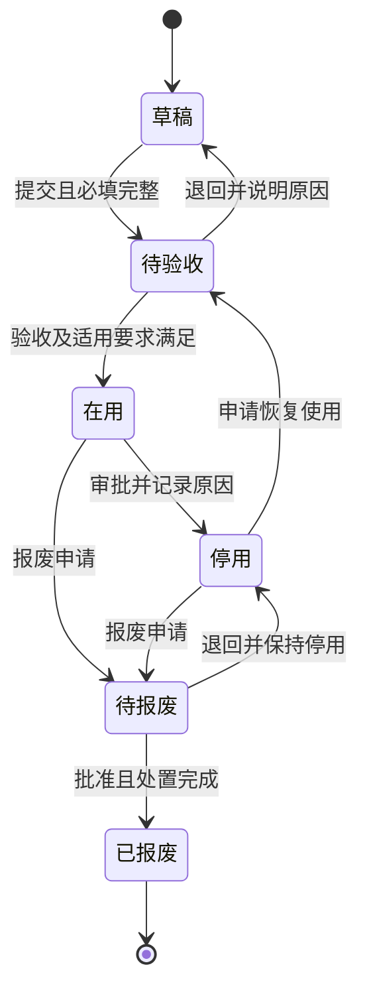
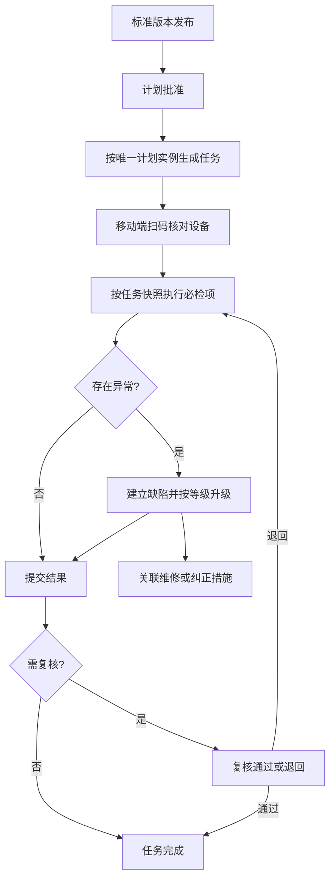
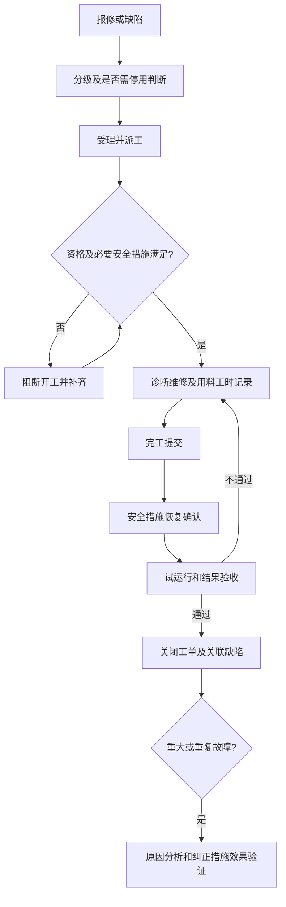
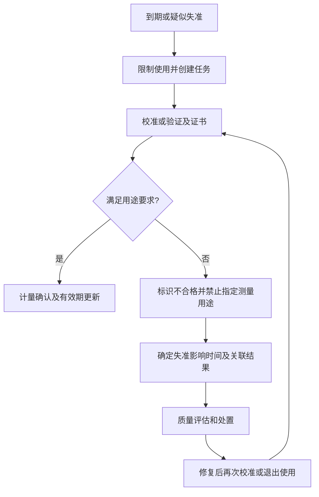

# EAM 角色、场景、流程、字段与验收设计

日期：2026-10-09。版本：v0.1，供评审的业务设计；未实施、未验收。

## 0. 设计依据与范围

目标：重构后覆盖现有设备业务，并支持设备全生命周期、现场维护和管理证据。ISO 9001 是用户举例，不是唯一依据；体系和标准由设备场景及适用性决定。

约束：在 steccn-eam-api/biz 中重构新表和新接口；现有调用方暂不改，由原服务入口适配 EAM。PC 与移动端均从现有系统平台进入设备管理二级主页面，再展示模块内角色工作台和业务导航；沿用平台身份与全局导航。两端共用权限、业务规则及记录模型。保留现有用户工作区改动。

现状依据：[设备业务清单](2026-10-09-设备业务梳理与重构边界.md)。Nacos 已核验；数据库、Kafka 与业务运行尚未验证。未发现当前仓库包含设备前端，以下页面为新系统设计。

五项交付：角色—场景矩阵、流程与状态图、字段与体系映射、双端页面清单、现有功能验收矩阵。新增闭环列入目标范围，但与已存在功能分别验收。本文不包含完整 DDL、接口规格或实施计划。

### 0.1 从业务决定体系与标准

| 编号 | 领域与依据 | 选择理由及适用边界 | 系统设计映射 |
| --- | --- | --- | --- |
| STD-01 | ISO 55001:2024 资产管理 | EAM 核心设计参考，管理资产生命周期、风险、价值和成本；不默认要求取得认证 | 关键度、责任、生命周期、策略、成本与绩效 |
| STD-02 | ISO 9001:2026 质量管理 | 对生产与产品质量相关设备提供质量管理支撑；不是所有字段的唯一来源 | 适用性、维护、能力、受控记录、异常与纠正措施 |
| STD-03 | ISO 10012:2026 测量管理 | 用于承担测量用途的设备与测量过程；过程温度读数并不自动等于需强制检定 | 测量要求、校准/验证、计量确认和失准影响追溯 |
| STD-04 | ISO 45001 职业健康安全管理 | 现场维修、危险设备和承包商作业 | 风险识别、措施、资格、作业许可关联与恢复确认 |
| STD-05 | ISO 12100:2010 机械安全 | 机械风险评估和改造设计参考；软件审批不能替代实体防护或安全控制 | 危险源、风险评估、保护措施与改造验证 |
| STD-06 | ISO 17359:2018 状态监测 | 用于建立机器状态监测与诊断流程 | 测点、采样、基线、阈值、诊断与维护建议 |
| STD-07 | ISO 14224:2016 可靠性维护数据 | 原范围为石油、石化和天然气行业；本项目只借鉴分类、故障及维修数据方法，不宣称行业适用认证 | 故障部位、模式、原因、维修方式、停机与维修时间 |
| STD-08 | ISO 14001:2026 环境管理 | 对环保设施和具有环境影响的设备启用 | 环境关联、异常事件、废弃物处理和处置记录 |
| STD-09 | ISO 50001:2018 能源管理 | 对重要用能设备启用，能源业务继续与现有 EMS/数据平台集成 | 用能关联、运行条件、计量点、基线和能效指标 |
| STD-10 | IEC 62443 系列 | 对连接工业采集与控制网络的资产及集成边界参考；不把 EAM 当 PLC 控制系统 | 来源可信、区域边界、账号权限、远程维护及变更记录 |
| STD-11 | 法定设备检验及计量要求 | 按所在地、设备类别和用途建立适用性台账；未核验具体法规，本文不指定法定周期 | 登记、适用依据、检验、证照、到期和使用限制 |

这些是基于业务的设计选择，不是所有企业必须同时实施或认证的标准清单。公开页面仅支持标准范围和版本核对；逐条符合性应以正式标准、实际制度与适用性评估建立。标准目录记录版本、有效期和适用范围，支持旧制度向新版迁移，不擅自改变既有认证版本。

### 0.2 设计默认取舍

- EAM 负责设备及部位、维护策略、作业、状态与证据；组织、账号、通知沿用平台能力。
- 备件库存和出入库权威来源维持现有系统；EAM 管理设备备件关联、作业用料与同步记录。
- 原始信号存储先维持数据平台；EAM 形成归一化状态事件和可重算运行区间。
- 停机不等于故障，告警不必然停机；业务运行状态变更不发送物理启停控制命令。
- 先形成全量设计，再分期实现；迁移完成不能以只完成台账代替现有报表、同步和集成覆盖。

## 1. 角色—场景矩阵

权限判定：操作权限 ∩ 组织/设备数据范围 ∩ 任务关系 ∩ 当前状态 ∩ 人员资格。后端逐次校验；菜单隐藏不能替代权限校验。多角色叠加不能绕过职责分离。

| 角色 | 场景与操作 | 数据范围 | 移动端重点 | PC 重点 | 限制/证据 |
| --- | --- | --- | --- | --- | --- |
| R01 操作人员 | S02 查看设备、S03 点检、S04 报修 | 本组织授权设备与分配任务 | 扫码、读数、拍照、报修 | 历史查询 | 不修改标准或关闭自己的报修验收 |
| R02 点检人员 | S03 执行、异常登记 | 分配路线/任务 | 步骤、测量、附件、提交 | 结果与趋势 | 不覆盖已提交结果；纠正需原因和版本 |
| R03 维修人员 | S04 接单诊断维修、S05 保养 | 指派工单及所需设备资料 | 措施、用料、工时、试运行 | 历史与技术资料 | 必要措施与资格不满足时禁止开工 |
| R04 班组长/车间主管 | S03 分配、S04 派工与生产协调、S05 验收 | 所辖组织 | 待办、现场确认 | 排程、逾期、工作负荷 | 高风险作业执行人与最终验收人分离 |
| R05 设备工程师/管理员 | S01 建档、S05 策略、S07 改造、S10 分析 | 授权设备域 | 现场核查 | 台账、树、标准、故障分析 | 关键字段和标准变更需版本及审批 |
| R06 计量人员 | S06 校准、验证及计量确认 | 适用测量设备 | 标签、结果与证书 | 周期、失准影响追溯 | 失准解除需评估和确认，不允许手改有效期绕过 |
| R07 质量人员 | S06 影响评估、S09 纠正措施、S11 审核 | 授权质量相关设备与记录 | 异常确认 | 关联批次、效果验证、证据 | 批次/产品数据引用质量或生产权威来源 |
| R08 安全/环境人员 | S04 作业风险、S07 改造、S08 检验 | 授权高风险及环境设备 | 措施核查 | 风险、资质、到期和异常 | 高风险许可按适用规则阻断，例外也须授权留痕 |
| R09 备件人员 | S04 领退料、S05 准备备件 | 授权仓库及用料单 | 扫码领退 | 可用量、替代件、同步 | 库存由原系统确认，重试不能重复扣减 |
| R10 管理层 | S10 绩效与更新决策 | 授权组织汇总 | 摘要和重大异常 | 风险、成本、可靠性 | 默认查看，审批权限单独授予 |
| R11 审核人员 | S11 证据检索、发现登记及整改验证 | 指定范围与时间窗口 | 现场证据查看、发现登记 | 追溯、导出及整改验证 | 被审核记录只读；发现登记/验证单独授权，导出留痕及脱敏 |
| R12 外部维保人员 | S04/S05 指定任务 | 指定工单、时间限定 | 执行和提交 | 受限资料 | 临时授权、有到期时间，附件下载同样受控 |
| R13 系统管理员 | 权限、集成、字典、运行维护 | 配置范围 | 状态查看 | 系统配置 | 不自动获得业务验收权，不篡改审计记录 |

### 1.1 场景与完成条件

| 场景 | 起点 | 主责 | 完成条件 |
| --- | --- | --- | --- |
| S01 建档投用 | 新设备/历史迁移 | R05、R04 | 主数据、责任、适用要求、验收及策略确认 |
| S02 状态查看 | 扫码/设备列表/信号 | R01、R05 | 显示状态来源、更新时间、离线或陈旧提示 |
| S03 点检 | 已发布计划生成任务 | R02、R04 | 必检项完成、异常处理关联、结果可追溯 |
| S04 故障维修 | 报修/缺陷/告警确认 | R03、R04 | 安全恢复、试运行、验收、原因和用料工时记录 |
| S05 预防维护 | 周期/时长/状态触发 | R05、R03 | 作业完成、结果验收、下次触发更新 |
| S06 计量 | 到期/失准/用途变化 | R06、R07 | 确认适用性；失准影响和处置闭环 |
| S07 改造停用报废 | 变更申请 | R05、R04、R08 | 影响评估、批准、验证、资料及关联更新 |
| S08 专项检验 | 适用要求及到期计划 | R05、R08 | 检验结论与限制更新，不合格不自动恢复使用 |
| S09 纠正改进 | 重复/重大故障或审核发现 | R05、R07 | 原因、措施、责任、期限、效果验证 |
| S10 分析 | 授权时间/组织筛选 | R05、R10 | 显示指标口径、数据覆盖和追溯链接 |
| S11 审核 | 设备/工单/标准检索 | R11 | 证据链包含历史版本、操作和关联，导出可追溯 |

## 2. 流程与状态图

### 2.1 设备生命周期

已报废设备不可恢复、不可生成新作业；历史记录保留。拆装与调拨记录位置/组织的有效时间，不删除历史。停用仍可进行经授权的检修和检验，但不允许未经验收恢复生产用途。

### 2.2 独立状态维度

| 维度 | 值 | 更新依据 |
| --- | --- | --- |
| 生命周期 | 草稿、待验收、在用、停用、待报废、已报废 | 业务审批 |
| 运行 | 运行、待机、停机、未知 | 有效采集事件/授权人工修正；陈旧信号转未知 |
| 健康 | 正常、预警、故障、待验证 | 告警、诊断、缺陷及验收 |
| 计量 | 不适用、待确认、有效、到期、不合格 | 适用性、日期、计量确认 |
| 安全可用性 | 可用、限制、禁止 | 风险措施、检验及许可 |

使用许可综合这些维度计算；系统业务许可不能代替现场安全联锁。旧 state=0/1/2/3 由兼容层映射为运行/告警投影；同时运行与告警时旧投影优先告警，转换规则须版本化，不丢失内部独立状态。

### 2.3 点检和异常

任务状态：待执行 → 执行中 → 待复核 → 完成；不需复核时提交直接完成。退回保留提交版本。取消需权限及原因。逾期是时间标记，不取代任务状态。点检完成不等于相关缺陷关闭。

### 2.4 维修和恢复使用

工单状态：待受理、待派工、待开工、执行中、暂停、待验收、已关闭、已取消。暂停记录原因及恢复条件；受理前可撤回，开工后取消必须记录现场恢复和审批。验收失败保留原记录并退回执行。重开生成修订或关联新工单，不直接覆盖关闭记录。

### 2.5 校准与失准

计划延期不自动延长有效期。按用途确定限制范围；历史校准结果与证书不得用新结果覆盖。

### 2.6 状态事件与统计

消息校验 → 标签映射 → 去重与事件时间排序 → 原始事件留存 → 更新当前状态 → 生成/修正运行区间 → 指标计算。迟到事件可重算历史，但不能无条件覆盖较新当前状态；无映射进入异常队列。仅在状态变化时计算启停次数，同值重复不增加次数。

区间按 [开始,结束) 计算，时长存秒；查询补入开始时间之前最后一个有效状态并裁剪边界。无数据区间标为未知，不当作停机。业务日和班次统一配置，支持现有 08:00 边界；报告显示时区、单位和口径版本。

## 3. 字段及体系映射

以下是逻辑字段设计，不是已核验数据库 DDL。M=提交或投用时必填；C=按类型/场景必填；S=系统生成。草稿允许不完整。扩展字段不能替代核心字段与约束。

| 对象/建议表 | 主要字段及规则 | 体系参考 | 留存证据 |
| --- | --- | --- | --- |
| 设备 eam_equipment | M: code、name、categoryId、ownerOrgId、locationId、responsiblePersonId；C: model、serialNo、manufacturer、commissionedAt、assetNo；S: id、version、lifecycleStatus；parentId禁止循环，编码范围内唯一 | STD-01/02 | 投用验收、调拨、修改历史 |
| 分类与部位 | M: categoryCode、name；部位 equipmentId、partCode；分类模板版本和专业属性 | STD-01/07 | 分类规则、旧 id 映射 |
| 适用性 eam_requirement_applicability | M: equipmentId、requirementId、applicable、reason、evaluatedBy、effectiveAt；C: reviewAt、restrictionRule | 全部 | 为什么适用/不适用及批准依据 |
| 要求目录 | M: code、title、type、edition、source、scope、effectiveFrom；C: clauseReference、effectiveTo；type区分标准/法规/企业制度 | 全部 | 版本变更及适用规则 |
| 风险评估 | M: equipmentId、hazard、consequence、likelihood、riskLevel、control、owner、reviewDate；方法及量表版本 | STD-01/04/05/08 | 评估、剩余风险、措施确认 |
| 点检标准 | M: itemCode、method、resultType、acceptanceRule、revision；C: unit、range、upper/lowerLimit、requiredEvidence、requiredQualification；数值上下限校验 | STD-02/06 | 发布审批、有效期 |
| 维护/点检计划 | M: equipmentScope、standardRevision、triggerType、responsibleRole、effectiveFrom；C: interval、runtimeThreshold、conditionRule、calendar、duePolicy | STD-01/02/06 | 批准、停用、调度记录 |
| 任务及结果 | M: taskId、equipmentId、itemSnapshot、actualValue/result、executor、executedAt；C: photo、exceptionReason、defectId；S: submissionRevision、serverReceivedAt | STD-02/06 | 原始结果、复核、纠正历史 |
| 缺陷/故障 | M: equipmentId、detectedAt、description、severity、source；C: partId、failureMode、cause、impact、downtimeStart/end、workOrderId | STD-02/07 | 发现、诊断、处置及复核 |
| 工单 | M: code、equipmentId、type、priority、scope、assignee、status；C: permitId、isolationConfirmation、diagnosis、repairAction、laborSeconds、usedParts、testResult、acceptanceBy | STD-01/02/04/07 | 执行、恢复确认、验收、成本 |
| 测量资源 | C: purpose、range、resolution、accuracyRequirement、calibrationMethod、interval、certificateId、traceabilityReference、confirmationResult、confirmedBy、validUntil | STD-02/03 | 用途适用性、证书、失准评估 |
| 检验登记 | C: registrationNo、inspectionType、basisVersion、inspectionBody、reportId、conclusion、nextDueAt、restriction | STD-11 | 检验报告、合法适用依据 |
| 状态事件 | M: equipmentId、source、eventId/dedupKey、eventAt、receivedAt、rawValue、normalizedState、mappingRevision；C: correctionReason | STD-06/10 | 来源、映射、重复及修正记录 |
| 运行区间 | S: equipmentId、state、startAt、endAt、durationSeconds、sourceEvents、calculationRevision、coverage | STD-01/06 | 可回放区间与统计口径 |
| 设备备件与用料 | M: equipmentId、externalMaterialId、unit；C: substituteApproval、quantity、externalIssueId、returnId、costSnapshot | STD-01/02/07 | 领退料、替代审批、同步结果 |
| 环境/能源关联 | C: environmentalAspectId、wasteRecordId、meterId、energyType、baselineId、operatingCondition、indicatorUnit | STD-08/09 | 来源记录、基线版本、异常处置 |
| 人员资格关联 | M: personId、qualificationType、scope、validFrom；C: validUntil、certificateId | STD-02/03/04 | 授权、资格校验快照 |
| 纠正措施 | M: findingId、rootCause、action、owner、dueAt、verificationMethod、verificationResult、verifiedBy | STD-02/04/08 | 从问题到效果验证 |
| 文件与审计 | S: actor、objectId、action、before/after、reason、time、requestId；文件 revision、hash、accessScope、retentionPolicy | 全部 | 原版本、操作链和导出记录 |

统一规则：记录签署包含账号、角色、时间、结论、意见及所依据版本；普通账号确认不宣称法定电子签名。附件鉴权、存储权限与对象权限一致。已批准标准和已提交结果通过修订更正；不物理删除历史证据。保存期限按适用要求配置，法律保留期间阻止清理。时间同时保留事件时间和服务接收时间。

## 4. 双端页面清单

菜单层级、角色入口、路由及按钮归属见 [EAM 功能菜单设计](2026-10-10-功能菜单设计.md)。

页面编号用于关联验收。桌面页面强调配置、批量与分析；移动页面强调现场任务，不把完整 PC 表格压缩到手机。

| 页面 | PC | 移动端 | 角色/场景 | 关键交互 |
| --- | --- | --- | --- | --- |
| P01/M01 工作台 | 待办、排程、组织指标 | 我的任务、扫码、紧急报修 | 按角色/S02-S10 | 同一人多角色可切换，显示逾期及高风险 |
| P02/M02 设备目录/详情 | 树、筛选、建档、批量导入、关联资料 | 扫码详情、状态、历史、资料 | R01-R08/S01-S02 | 状态来源和更新时间、权限受控资料 |
| P03 设备建档与变更 | 模板、投用、调拨、停用、报废 | M02现场补充草稿及拍照 | R05/S01-S07 | 批量导入预检和错误清单，关键字段批准 |
| P04 标准及计划 | 项目、维护标准、版本、周期和触发规则 | 查看任务标准快照 | R05/S03-S05 | 发布影响评估、旧任务保持旧版本 |
| P05/M03 点检任务 | 分配、进度、复核 | 步骤执行、读数、照片、草稿 | R02/R04/S03 | 异常即时关联缺陷，必检项未填不能提交 |
| P06/M04 缺陷报修 | 分级、关联、处理队列 | 扫码报修、语音文字/照片、进度 | R01-R05/S04 | 疑似重复提示，不静默丢弃新报修 |
| P07/M05 维修保养工单 | 派工、排程、用料、验收 | 接单、措施确认、执行、暂停、完工 | R03/R04/R08/S04-S05 | 开工阻断、试运行及验收退回 |
| P08/M06 校准计量 | 计划、证书、确认、影响评估 | 扫码核对、结果、证书 | R06/R07/S06 | 失准与逾期限制，受影响结果查询 |
| P09/M07 风险与检验 | 风险、登记、检验及到期 | 现场措施与证据核查 | R05/R08/S07-S08 | 条件字段、许可关联、恢复使用验证 |
| P10/M08 备件与用料 | 设备 BOM、替代件、ERP 同步、导出 | 工单领退料及数量确认 | R03/R09/S04-S05 | 显示库存来源，失败状态可重试 |
| P11/M09 状态与运行 | 状态树、启停记录、运行报表 | 当前状态、近期事件、异常提示 | R01/R05/S02-S10 | 未知状态、区间边界、统计单位明确 |
| P12/M10 点检温度看板 | 完成率、合格率、温度表/趋势、原料看板 | 授权范围摘要、设备趋势 | R04/R05/R10/S10 | 班次和业务日、无数据区分零值 |
| P13 监控与集成 | 信号映射、阈值、同步日志、失败队列 | M01异常待办 | R05/R13 | 配置版本、权限、重试审计 |
| P14/M11 纠正与审批 | 原因分析、效果验证、变更审批 | 待办、意见、现场核查 | R04-R08/S07-S09 | 退回/委派留痕，不允许越权签署 |
| P15 审核证据中心 | 时间线、历史版本、关联记录、授权导出 | M02现场只读证据 | R11/S11 | 导出范围预览及审计 |
| P16 系统及要求配置 | 角色范围、能力、字典、标准适用性、保留规则 | 个人设置 | R13 | 权限变更记录，管理员无默认业务批准权 |

### 4.1 移动端与 PC 通用验收规则

- PC 主要视口 1280×720、1920×1080；移动端 360×800、390×844，核心流程无需横向滚动，触控目标不小于44px；表格用卡片/详情替代。
- 移动端扫码可手工输入替代；相机权限拒绝有替代录入。身份信息由服务端绑定，不信任表单提交的执行人。
- 弱网草稿只缓存必要数据；退出登录清除本地敏感数据。离线记录保留采集时间，在线后校验任务版本、资格和权限；冲突需显式处理。
- 审批、验收和使用放行必须在线完成。重复点击、断线重试使用幂等标识，不生成重复任务、用料或结果。
- 提交中、成功、失败、无数据、无权限、信号陈旧都给出明确状态。两端读取同一对象与版本，修改采用并发检查。
- 设计优先采用响应式 Web/H5；离线与扫码封装为可替换能力，不提前绑定小程序或原生 App。

## 5. 现有功能验收矩阵

证据状态全部为“待验证”；现有源码存在不等于运行通过。代码路径以仓库根目录为基准。兼容验收保存旧服务名、路径、请求及返回、旧 id/编码、授权和错误行为；原代码缺陷不得默默当作必须复制的业务行为，修正应记录口径差异。

| 编号 | 现有来源/契约 | 目标与页面 | 关键验收场景 | 所需证据 |
| --- | --- | --- | --- | --- |
| A01 | MesEquipmentServiceImpl.getEqpInfo；GET /mes/eqp/thirdParty | 设备和部位查询 P02 | 正常设备筛选、部位/维修方式、合法/非法 client-id；旧 id 映射 | API契约、数据库对账 |
| A02 | GET /feign/mes/eqp/getByCode | 兼容入口→EAM 查询 P02 | 编码存在/不存在、停用/删除、名称及模型字段 | 旧Feign集成 |
| A03 | POST /feign/mes/eqp/state | 明确状态映射 P11 | 启停、兄弟/父子、多层、无父节点、非法值；记录旧1语义冲突 | 状态规则与契约测试 |
| A04 | KafkaConsumer；eqp_signal_data_order | 信号映射与联动 P11/P13 | 脉冲、故障、运行/待机、专用设备关系、重复/迟到、映射缺失、缓存失效 | Kafka真实链路、事件回放 |
| A05 | GET /mes/eqp/dashboard/task | 点检完成统计 P12 | 组织/产线、时间范围、完成/未完成、空数据及分母为零 | 固定数据对账、页面 |
| A06 | GET /mes/eqp/dashboard/item | 点检项合格率 P12 | 分组织、合格/不合格、未执行项口径 | 固定数据及图表 |
| A07 | GET /mes/eqp/dashboard/task/monitor；SpotCheckTask | 点检率监控 P13 | 上下限、业务日、通知人、重复调度不重复通知、异常报告失败 | 调度/消息集成、对账 |
| A08 | POST /mes/eqp/dashboard/defect | 缺陷图表 P06/P12 | 日期、组织及类型筛选、计数和空结果 | API与图表 |
| A09 | GET /mes/eqp/dashboard/temperature/item | 温度项目 P04/P12 | 保持既有7项目及旧id映射，新项目配置 | 契约及配置 |
| A10 | POST /mes/eqp/dashboard/temperature/report | 温度报表 P12 | 动态产线表头、08:00/20:00班次、跨日、缺项、同分钟数据 | 样例报表对账、PC页面 |
| A11 | POST /mes/eqp/dashboard/temperature/lineChart | 温度趋势 P12/M10 | 项目/产线、排序、单位、无值断点 | 数值对账、双端页面 |
| A12 | POST /mes/eqp/dashboard/yl | 原料看板 P12 | 设备数量、运行/待机/停机/故障投影、点检率 | 组织样本对账 |
| A13 | POST /mes/eqp/operation/report | 运行报表 P11 | 分页、设备/部门/分类/状态筛选、累计与当前运行、最长最短及单位 | 区间回放、契约、页面 |
| A14 | GET /mes/eqp/num | 数量 P01/P02 | 统计范围与有效设备过滤 | 源码口径核对、对账 |
| A15 | POST /mes/eqp/test | 受控状态模拟工具 P13 | 迁移其业务规则，限制生产调用、模拟事件可追溯 | 管理权限与规则测试 |
| A16 | POST /feign/mes/eqp/changeReportData | 旧统计输入适配 | 原输入单位明确转换、相同请求重试、历史重算不叠加 | 采集调用集成、统计对账 |
| A17 | POST /feign/mes/eqp/ins/pao | 泡界线查询 | 日期与顺序、空数据、PMS响应不变 | PMS旧调用集成 |
| A18 | POST /data/platform/mes/signal | 采集入口保留 | 批量信号、异步竞态、乱序、重复、通知 | 采集→原入口→EAM集成 |
| A19 | POST /data/warehouse/mes/eqp/operationState | 启停时长 P11 | 查询起点之前状态、区间裁剪、停机次数、无数据与未知 | 已知事件序列、对账 |
| A20 | POST /data/warehouse/mes/eqp/operationRecord | 启停记录 P11 | 分页、时间排序、编码及设备名 | 数据平台旧契约集成 |
| A21 | GET /mes/spare/download | 备件导出 P10 | 列、编码、单位、数量及授权范围 | 文件内容与导出审计 |
| A22 | POST /mes/spare/synchronousSpare | ERP物料同步 P10/P13 | 新增/更新、分页、重复、失败后续跑 | ERP适配测试与实际联调 |
| A23 | POST /mes/spare/synchronousSpareLength | 物料尺寸同步 P10 | 长宽厚、空值、来源字段与转换 | 来源样本对账 |
| A24 | POST /mes/spare/synchronousSpareUnit | 单位同步 P10 | 单位换算、精度、重复同步 | 换算用例与对账 |
| A25 | GET /mes/spare/synchronousSpareToQms | QMS同步 P13 | 已有/新增、重试、响应失败 | QMS集成 |
| A26 | GET /mes/spare/supplier | 供应商查询 P10 | 编码过滤、返回关系、无数据 | 契约与来源对账 |
| A27 | Canal mes_eqp_spare/mes_eqp_spare_unit_conversion | 原同步链保留或兼容投影 | 增改删、单位、QMS/平台同步、断点恢复 | Canal链路与目标对账 |

### 5.1 新增能力验收矩阵

2026-10-10菜单复核新增B01-B11源码能力及契约覆盖，见 [菜单闭环与现有功能复核](2026-10-10-菜单闭环与现有功能复核.md)。它们与下表N类新建业务能力不同，不因原A矩阵只有27项而省略验收。

| 编号 | 能力/页面 | 验收场景 | 关联 |
| --- | --- | --- | --- |
| N01 | 建档投用/变更 P03 | 缺字段、循环父子、未验收投用、调拨历史、报废后禁止新任务 | STD-01/02、S01/S07 |
| N02 | 点检闭环 P04/P05/M03 | 标准版本冻结、调度幂等、漏项阻断、异常关联、退回修订 | STD-02/06、S03 |
| N03 | 工单闭环 P07/M05 | 无资格/无措施不能开工、暂停、验收失败、职责分离、安全恢复 | STD-04/05/07、S04/S05 |
| N04 | 计量 P08/M06 | 到期限制、校准不合格、用途适用性、影响区间及结果关联 | STD-03、S06 |
| N05 | 专项检验 P09 | 按类型启用字段和规则、证照过期、检验失败不自动放行 | STD-11、S08 |
| N06 | 风险与改进 P09/P14 | 高风险升级、原因/措施/验证闭环、重复故障关联 | STD-01/02/04/08、S09 |
| N07 | 状态与可靠性 P11 | 重复、迟到、无信号、事件回放、MTBF/MTTR有明确分母和停机范围 | STD-06/07、S10 |
| N08 | 审核 P15 | 历史标准/结果恢复、完整时间线、受限导出、附件鉴权 | 全部、S11 |
| N09 | 双端 P01-P16/M01-M11 | 视口、扫码替代、弱网草稿、并发冲突、跨账号数据隔离 | R01-R13 |
| N10 | 集成 P13 | 调用方不改、旧id映射、写入单一归属、通知幂等、失败队列 | A01-A27 |

MTBF、MTTR 等可靠性指标只在故障和有效时间数据充分时展示；缺失数据不生成虚假零值。新增能源、环境功能以记录关联和设备侧证据为范围，不复制完整 EMS/QMS。

### 5.2 验收证据记录格式

每项保存：编号、需求版本、场景、数据准备、期望值、实际值、执行环境、代码版本、证据路径、结果、差异与批准记录。区分静态检查、单元/契约、真实数据库/消息/服务集成、双端关键流程 E2E；未执行项为待验证，受外部依赖影响项记录具体阻塞原因。最终完成条件为 A01-A27、B01-B11 全部覆盖且新增批准范围通过，不用局部页面通过代替全矩阵。

优先双端 E2E：扫码点检→异常→维修→验收；校准失准→限制→评估→恢复；PC建档→移动查看；角色越权与外部维保隔离。数据/statistics的边界用可重放样本及集成验证，不要求每项都通过浏览器证明。

## 6. 设计评审与后续工作

本轮形成完整业务设计草案；未改变业务代码、表结构、Nacos配置或消费者部署。实现前核验真实数据结构、外部写入方、信号语义、备件权威来源及资格/批次集成可用性。缺失外部数据时显式人工关联并记录来源，不能宣称已自动追溯。

建议分期：设备基础与适配 → 状态/运行统计 → 点检及报表 → 维护、计量与证据 → 备件和专项扩展。分期只控制交付顺序，不删除现有功能。当前已形成首批逻辑模型和HTML演示；详细字段与物理结构、API契约仍待补齐。后续状态以 [进度入口](设计与原型进度.md) 和 [首批字段审查](页面设计/2026-10-10-首批字段与文档审查.md) 为准。

## 7. 官方参考资料

核对日期：2026-10-09。字段、页面、流程及适用性选择是本文设计推导，不能当成标准原文。

- [ISO 55001](https://www.iso.org/standard/83054.html)
- [ISO 9001](https://www.iso.org/standard/9001)
- [ISO 10012](https://committee.iso.org/standard/10012)
- [ISO 45001](https://www.iso.org/standard/63787.html)
- [ISO 12100](https://www.iso.org/standard/51528.html)
- [ISO 17359](https://www.iso.org/standard/71194.html)
- [ISO 14224](https://www.iso.org/standard/64076.html)
- [ISO 14001](https://www.iso.org/standard/14001)
- [ISO 50001](https://www.iso.org/standard/69426.html)
- [IEC 62443-2-1](https://webstore.iec.ch/en/publication/62883)

## 8. 2026-10-10设备全景与异常分流补充

[设备全景台账、异常分流与点检准备](页面设计/2026-10-10-设备全景台账与异常点检设计.md)补充P02/P04/P05/P06：台账集成全生命周期、图片/文档/可选3D；人工异常先登记事实，再分检查/维修/专业处理。既有维修图从确认需维修的异常开始，疑似异常不必直接生成工单；点检超限按受控规则复核/确认，不能一概判故障。标准/设备项目适用、路线、频次计划预维护，临时检查受控创建；多维状态保持独立。上述为设计补充，不是已实现功能。
