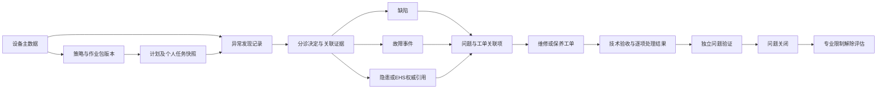
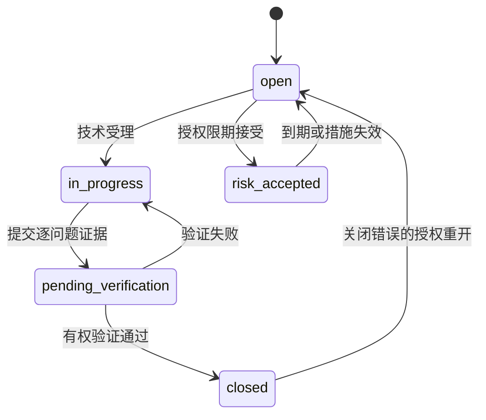

# 维护业务对象、流程与关闭规则基线

日期：2026-10-10。状态：模型设计基线，未实现生产服务。承接[可行性分析](../页面设计/2026-10-10-维护业务关系与标准化流程可行性分析.md)。本文件取代旧文档中“报修即缺陷”“验收自动关闭缺陷”的目标设计。2026-10-12静态复核：当前维护原型已包含独立发现/问题/工单模拟接口；`mock/work-rules.js`工单业务关闭分支更新工单状态，隐患安全放行另有独立操作，不应继续将“旧HTML全部待迁移”视为现状。但这只是指定源码路径的静态核验，仍须逐页、逐动作及自动化回归确认不存在遗留的隐式关闭；正式数据库与接口尚未据此认定完成。

## 对象边界与设备档案聚合

异常发现描述“看到了什么”；缺陷记录可修复的技术偏离；故障事件记录功能失效及恢复；隐患记录安全风险及治理。一次发现可产生多个独立问题，多个发现可关联同一问题；不存在必须按“异常→缺陷→故障→隐患”依次升级的流水线。故障可以同时关联缺陷和隐患。风险评估为这些对象提供判断依据，不代替问题本身。

点检与日常保养是活动；维修工单是技术处置载体。轻量保养任务须满足低风险、已批准作业包、授权人员和证据要求；涉及隔离、特殊作业或复杂资源的任务转为工单。档案只聚合上述来源记录，按当前权限显示并跳转，不创建第二份台账。每个对象具有独立ID，共用caseId进行追踪，caseId不是替代外键的业务主键。

## 角色与职责分离

| 动作 | 责任角色 | 必要条件 |
| --- | --- | --- |
| 记录发现与补证 | 授权现场人员、点检员、维修人员、监测系统 | 设备范围授权；来源、发生时间、现象；紧急控制可先实施后补录 |
| 分诊与关联 | 设备工程师或维修主管 | 核实功能影响、风险、已有问题及处理建议；保留决定版本 |
| 技术派工与验收 | 维修主管或授权设备工程师 | 人员资格、工作范围；验收者不得为该次执行主责人 |
| 缺陷验证 | 授权设备工程师或技术复核人 | 逐问题结果及证据；高风险须独立于整改执行人 |
| 故障恢复确认 | 授权运行人员与技术人员 | 功能恢复依据、时间区间、试运行结果；不能以工单关闭推断恢复 |
| 隐患验证和关闭 | 安全职责人员，或EHS权威流程 | 依法适用的治理要求、复查与审批；EAM不得覆盖EHS关闭结论 |
| 风险接受 | 按风险等级授权的业务责任人 | 依据、期限、措施、复评日期；禁止用接受替代法定整改 |
| 专业放行 | 与限制类型匹配的安全、计量等授权人员 | 各项限制分别验证；技术验收不解除限制 |
| 系统管理 | 平台管理员 | 管理配置，不默认获得业务审批、关闭或放行权限 |

角色、组织设备范围、记录关系、资格有效期和状态共同决定动作权限。代理审批记录实际操作者、被代理人和授权来源；批量操作逐条校验并返回失败原因。移动端优先现场发现、执行与补证；PC优先分诊、配置、排程、审查。双端使用同一状态与权限规则。

## 状态机与转换条件

状态码登记见[设计登记](维护业务设计登记.json)。以下为业务状态；运行、健康、生命周期、使用许可为不同维度，未知信号不得默认正常。

| 对象 | 主路径 | 分支与约束 |
| --- | --- | --- |
| 发现 | draft→submitted→triaged→archived | triaged必须已有分诊决定和问题关联，或有证据说明无需建问题；错误记录可void，保留原因；archived只表示分诊已归档 |
| 缺陷 | open→in_progress→pending_verification→closed | 验证失败返回in_progress；risk_accepted仍是未解决状态，期限到期回open；错误登记走void并保留独立批准；closed复发应新建问题关联前例，关闭错误用授权reopen审计 |
| 故障事件 | reported→confirmed→restored→verified→closed | 误报经证据核实void；restored必须有恢复时间与功能证据，verified确认分类和停机区间；恢复失败回confirmed；关闭后再次失效新建事件 |
| 隐患 | open→rectifying→pending_review→closed | 复查失败返回rectifying；临时控制是措施记录而非closed；EHS权威模式只接收带版本的结果；错误记录void需相应权限 |
| 工单 | draft→approved→assigned→executing→technical_complete→accepted→closed | 执行可paused；验收退回executing并增加执行版本；未开工可cancelled，开工后终止须记录处置和剩余工作；closed不改变问题状态 |
| 保养任务 | pending→executing→submitted→verified→closed | 无法执行须blocked及原因、补做安排；延期审批保留原到期时间；取消不可伪造完成率 |
| 计划 | draft→reviewing→published→suspended→retired | 审核退回draft；变更发布新版本，历史任务不覆盖；恢复published重新评估窗口，不自动补发所有历史任务 |
| 专业限制 | active→pending_release→released | 复核失败回active；不同专业各自关闭，任何active项仍限制对应用途 |

工单技术完成可提交部分关联问题的处理结果。业务关闭要求逐关联项具备“已解决并已送验证”或“未解决但有经批准的后续工单/责任/期限/有效控制”；重大或依法不得残留的风险阻止关闭。问题仍由其验证流程独立关闭。关联项记录resolved、unresolved、not_applicable及证据，禁止使用一个defectVerified布尔量覆盖所有问题。专业放行是独立动作，不能随验收批量隐式执行。

## 标准业务流程及异常分支

1. 现场人员、点检结果、保养执行或监测告警创建发现记录。遇即时危险先依现场规程控制并通知，再补录；EAM记录不等于物理隔离或停机。
2. 分诊核实事实、功能影响和风险；提示同设备/部位/现象已有问题。关联已有问题保留每条发现证据；监测告警可按窗口聚合，原始告警可追溯。无问题归档需理由，重大风险不得由发现人直接忽略。
3. 分别登记缺陷、故障、隐患，指定每个问题主责、期限及控制措施。故障状态联动通过受控运行事件实现；隐患有EHS时以EHS为权威，未确认已有EHS服务前仅设计适配契约。
4. 按处置范围创建一个或多个工单，允许多问题合单；只禁止同一问题同一处置范围的重复活动派工，不禁止该问题的不同专业工单。
5. 派工、资格、作业许可和隔离检查通过后执行；许可过期、范围变更、安全措施失效应阻断继续作业并复评，保留暂停原因。
6. 执行提交工时、用料、装拆、试运行、逐问题结果；验收退回产生新执行版本，旧证据只读。
7. 工单关闭与问题验证分别进行；残留问题继续跟踪。复查失败回整改，逾期升级。全部相关专业限制分别放行，设备用途许可再按规则计算。

计划触发支持日历、累计运行量、启停次数和状态条件；明示OR/AND组合、时区、窗口、截止规则及提前容差。计数器重置/更换/补数记录基准和修正版本，不把读数回落当作新周期。策略、作业包、标准、设备适用范围和人员候选池均使用版本快照；计划绑定多人/岗位，任务只有一名主责，可有协作人员；岗位人员变动不覆写已派任务。补生成使用计划版本＋设备＋周期窗口＋任务类型的幂等键，失败重试不制造重复任务。

故障统计区分总停机、主动修复、等待、试运行；同一故障关联多工单时停机按区间并集去重。MTBF/MTTR必须公开设备范围、故障定义、观察窗口和有效时长；数据不足显示不可计算。更换记录实际实例、序列号、装拆位置、时间、领退料来源、工单和寿命基准；不能只修改BOM文本。

## 兼容与迁移边界

旧reports与reportId不直接作为新正式结构。迁移先按来源与证据区分发现和问题，模糊记录进入人工核实队列；旧验收记录可作为历史证据，不能伪造新制度下独立验证。保留旧调用契约，经适配层映射并登记无法表达的多问题信息；不让旧接口自动关闭新问题。命令须具备expectedVersion、idempotencyKey和审计，附件失败重试与集成回调不得倒退已确认版本。组织/租户隔离、原文件权限和审计保留从设计期纳入。

体系适用范围沿用可行性分析已核实来源，ISO 14224分类按工业场景裁剪；不是所有设备必须配置所有体系字段。本基线不声称满足标准全部条款或获得认证。
