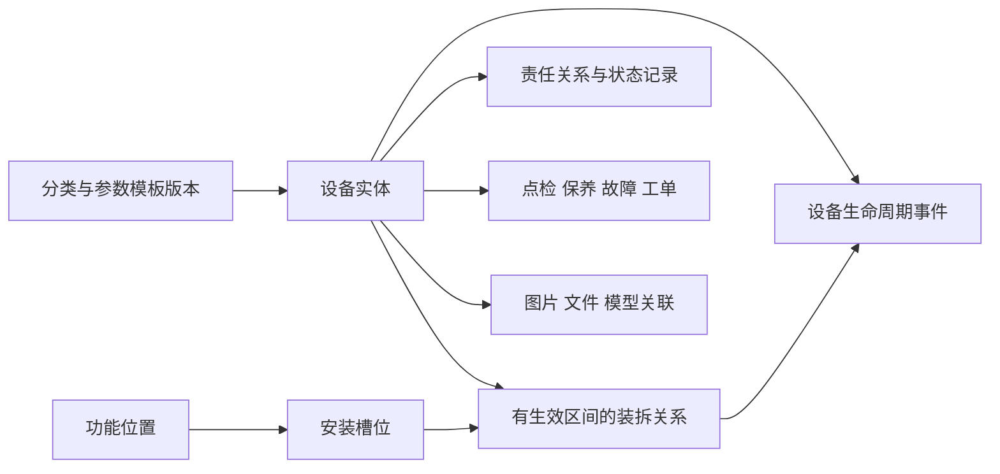

# 设备台账核心逻辑模型与原型改造清单

> 最新PRD及用户回复恢复独立功能位置；本篇相反决定为历史记录。当前以PRD重设计模型为准。

> 后续决定已覆盖其中功能位置/槽位及旧推进顺序：取消这两类对象，保留所属位置与变更历史；分类参数独立菜单，档案按14页签组织。本文保留为历史设计依据。

日期：2026-10-10。接续设备台账扩展可行性分析。以下为本轮建议设计基线与候选记录，不是正式表名、DDL、API契约或已实现功能。现有HTML仍使用原模拟模型；正式设计在所有模型完成后统一收敛。

## 核心对象与候选字段

| 逻辑对象 | 候选字段/关系 | 约束 |
| --- | --- | --- |
| 设备实体 | id、tenant_id、code、name、classification_id、type_id、asset_property、maintainable、criticality、manufacturer_id、serial_no、revision | id永不复用；code租户内默认唯一，旧编号保留历史别名；名称不作导入匹配键 |
| 分类/类型 | id、parent_id、code、name、status、template_version_id | 分类与类型定义层级语义；禁循环；停用不删除历史引用 |
| 编码历史 | equipment_id、old_code、new_code、effective_at、reason、approved_by | 旧码查询返回原实体并标记历史编号；不得静默重新分配给另一设备 |
| 功能位置 | id、parent_id、code、name、site_ref、process_unit、tag、revision、status | 与行政组织分离；Tag默认在厂区/工艺范围唯一，允许不同槽位；设备实体不直接占有永久Tag |
| 安装槽位 | id、functional_location_id、code、capacity、allowed_type_ids | 单占位默认capacity=1；多设备位置用多个槽位/明确容量，不限制整个位置仅一设备 |
| 装拆关系 | id、equipment_id、slot_id、parent_equipment_id、valid_from、valid_to、installed_by、removed_by、source_event_id | 同一实体安装区间不得冲突；装配父子关系禁循环；未安装设备可在库/检修/运输 |
| 责任关系 | equipment_id、organization_ref、responsibility_type、person_or_team_ref、valid_from/to | 使用/管理/维修责任分开；同类主负责人默认一个；岗位任职来源复用平台 |
| 参数定义 | code、name、data_type、unit、precision、range、enum_values、required_stage、searchable | 单位与类型可校验；报警规则不写在模板必填规则中 |
| 模板版本 | template_id、version、classification_id、definitions、status、effective_at | 草稿可改；发布不可覆盖；变更分析设备适用影响 |
| 参数值/适用关系 | equipment_id、template_version_id、parameter_code、value_kind、value、source、revision、deviation_ref | value_kind区分设计/额定/允许范围；设备差异经审批；实时值属于测点数据 |
| 状态记录 | equipment_id、dimension、value、source、observed_at、received_at、quality、revision | 生命周期/运行/健康/计量分开；管理冻结、使用限制独立对象 |
| 变更申请/事件 | object_ref、command、before/after、effective_at、recorded_at、reason、requester、approver、revision、source_document | 申请、审批、执行区分；实际执行产生事件，申请不提前修改当前值；补录保留双时间 |

组织/人员/岗位、物料、供应商、财务资产主数据优先引用现有平台来源。设备与财务资产映射允许一对多/多对一，避免绑定唯一资产编号的未经验证假设。普通部位可留在部位对象；需要独立追溯的电机/可维修部件升级为实体实例，并明确旧部位映射。

## 关系示意

## 状态与校验门槛

主数据发布状态与物理生命周期独立：草稿→待审核→有效；退回回草稿；关键字段变更产生申请；新发布版本不覆盖历史。已有有效设备仍沿用当前演示流程，待原型改造时完成映射。

目标生命周期：待安装→调试中→在役；在役可封存，复用需复验；任何允许申请报废的阶段→待报废→已报废，驳回恢复申请前状态。设备草稿是发布状态，不是物理生命周期；当前“停用”必须在迁移时按原因映射封存/使用限制，不能直接批量替换。暂时停车属于运行状态。

运行状态：运行/停止/待机/未知；健康：正常/关注/预警/严重异常/未知。当前“待确认/故障”等值暂留兼容，后续提供映射和来源依据。计量合格、使用许可及管理冻结保留独立维度；任何状态名调整不得绕过现有维修、安全、验收守卫。

草稿仅要求最小身份与分类；发布要求责任范围、分类必填参数；安装要求有效槽位与类型匹配；投运要求适用验收/合规证据及使用许可。必填按分类与阶段确定，所有设备无需填所有技术字段。

## 关键操作流程

新增：草稿→校验预览→提交→按规则独立审核→发布。已引用设备不可物理删除；草稿删除按引用检查。

移位：选择实体/目标槽位→预校验占用、类型、作业许可和版本→申请/审批→现场执行确认→原区间关闭、新区间开启→更新位置投影及事件。审批通过不代表已经移位。

更换：旧实体拆下→记录去向→新实体安装→关联同一次更换事件→复验/许可。两实体分别保留历史；位置履历可串联两者。多个动作作为一个业务执行单元，失败不能留下双占位或无来源关系。

模板升级：新版本发布→影响预览→设备适用变更审批→参数补录/验证；旧任务和旧维修证据仍引用旧快照。禁止修改单位后无转换地沿用旧数值。

补录/更正：有效时间与记录时间分离；已发生关系有重叠时拒绝并提供冲突清单。错误历史通过更正事件及修订表达，不抹除审计。

## 角色与场景

操作人员：查看身份/状态、扫码、异常上报；工程师：分类参数/结构、变更申请；主管：责任分配、变更审核；维修人员：装拆执行与试验记录；质量/安全/计量人员：适用证据审查和限制解除；审计：版本、事件和来源追溯。申请人与审核人独立约束按变更风险配置，既有维修自验限制继续适用。财务字段和受控资料下载单独授权。

## 原型改造顺序与候选接口

| 顺序/页面 | 必须呈现的场景 | 候选对象 | 候选接口（逻辑命令） |
| --- | --- | --- | --- |
| 1 分类与参数模板维护 | 列表/新增/编辑/发布/停用/影响预览 | 分类、模板、定义、版本 | 查询分类与模板；保存草稿；校验；提交发布；影响分析 |
| 2 功能位置与槽位维护 | 位置树/位置详情/占用及历史/槽位类型约束 | 功能位置、槽位、装拆关系 | 查询树/详情/占用；维护位置/槽位；预校验 |
| 3 台账列表与维护表单 | 分类组合筛选/多维状态/动态参数/草稿发布/编码变更 | 设备、编码、参数、责任 | 分页查询；保存/提交/审核；参数校验；导入预览/执行；授权导出 |
| 4 设备全景详情 | 核心状态→概况/参数→结构安装→关联业务/资料履历 | 共享对象聚合 | 按页签查询聚合/分页事件；查询设备适用标准与版本 |
| 5 装拆移位更换 | 申请/审核/执行/取消/冲突/补录/追溯 | 变更单、关系、事件 | 变更预校验；提交/审核；执行；更正；查询版本 |

新页面进入现有菜单能力或作为设备内部操作页；新增菜单前核对55菜单总表，不能先承诺新增菜单数量。每页生成时登记具体候选路径、请求/返回字段、权限及错误，不把本表逻辑命令算入当前81项路径接口。

PC维护复杂模板与关系，移动端侧重扫码查询、现场执行、拍照和确认；允许移动录入基本草稿，高风险批量配置保留PC入口。所有操作共享后端规则，不能依布局获得额外权限。

## 验收与推进边界

需覆盖：旧码扫码仍定位原实体；同Tag更换设备不串历史；电机跨设备装拆履历跟随实体；双占位/环状结构拒绝；补录冲突可解释；模板单位变更有影响提示；审批未执行不改变位置；合规到期限制不能被生命周期变更解除；无成本权限仍可看维护；来源故障不阻断其他页签；导入部分错误有行级明细。

当前交付是逻辑模型及原型改造清单，尚未实现这些操作。下一步按顺序1、2先生成独立HTML及逐页候选记录，再改造台账表单/详情并进行跨页验收；此阶段不实施正式DDL、API或修改旧调用方。

[可行性分析](../页面设计/2026-10-10-设备台账扩展方案可行性分析.md) · [进度](../设计与原型进度.md)
