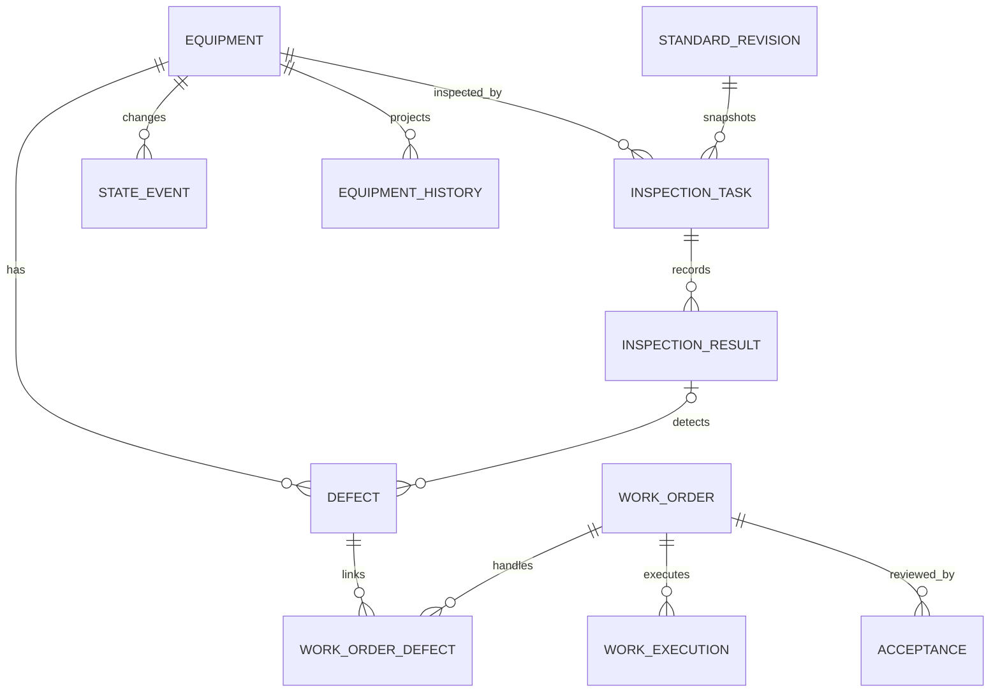

# 首批核心逻辑数据模型

> 最新台账资料、点检计划多岗位/人员及任务改派规则，以[本轮设计](../页面设计/2026-10-10-台账资料与点检责任设计.md)和逐页登记为准；以下旧字段/操作为此前阶段记录。

> 商用审计更新：当前20独立页面，详见[审计记录](../页面设计/2026-10-10-首批商用审计与优化记录.md)与[逐页表字段/API登记](../页面设计/页面记录/首批页面候选数据与接口索引.md)。最新顺序为全部页面模型完成后统一正式数据库/API设计，覆盖旧下一步安排。此前计数保留历史快照。

> CRUD补全更新：当前操作以[首批页面操作矩阵](../页面设计/2026-10-10-首批页面操作矩阵与交互验收.md)为准，字段关系见[维护数据补充](../数据设计/首批维护字段与数据关系补充.md)。此前记录保留阶段证据，附件仍为元数据，真实后端未接入。

> 2026-10-10更新：首批优化已落地12个独立HTML、8菜单部分场景及13角色工作台。下文原有审查/验证状态保留为阶段快照；当前交付、限制与待办以[首批优化交付与验证](../页面设计/2026-10-10-首批优化交付与验证.md)和[当前进度](../设计与原型进度.md)为准。物理数据库和真实API尚未实现。

日期：2026-10-10。逻辑设计，未执行DDL；实际主键策略、数据库类型、索引及迁移需后续核验。现有调用方通过旧id/code映射适配。

## 1. 实体关系

缺陷允许人工报修，resultId可空；一工单可处理多个缺陷，一缺陷可关联返修工单。履历是原记录的聚合投影，不能替代业务原始记录。标准引用版本并保存任务快照。

## 2. 核心字段与约束

| 对象 | 核心字段 | 约束/状态 |
| --- | --- | --- |
| equipment | id、code、name、parentId、categoryId、ownerOrgId、locationId、responsiblePersonId、model、serialNo、commissionedAt、lifecycleStatus、version | 编码在组织约定范围唯一；父关联不可成环；历史调拨单独记录 |
| equipment_state | equipmentId、operatingState、healthState、source、eventAt、receivedAt、version | 运行与故障分开；陈旧信号未知，不推断停机 |
| standard_revision | id、standardId、revision、method、resultType、unit、acceptanceRule、effectiveAt、approvalId | 发布版本不可覆盖；维护受控规则 |
| inspection_task | id、code、equipmentId、planInstanceKey、assigneeId、standardRevisionId、snapshot、scheduledStart/end、status、version | 生成实例唯一；pending/active/submitted/returned/complete/cancelled；完成策略是否复核可配置 |
| inspection_result | id、taskId、itemId、submissionRevision、numericValue、unit、checkResult、conclusion、executedBy、executedAt、receivedAt、attachmentIds | 数值保存精度与单位；结果修订保留前版；原型温度阈值80仅示例 |
| defect | id、code、equipmentId、resultId、source、description、severity、detectedAt、reporterId、status、version | open/accepted/processing/verified/closed；确认处置不等于故障解除 |
| work_order | id、code、equipmentId、type、assigneeId、status、priority、scope、version | assigned/active/paused/awaiting/returned/closed/cancelled；类型维修/保养；不能绕过验收 |
| work_order_defect | orderId、defectId、resolution | 联合唯一；关闭时核对每项缺陷处置 |
| work_execution | id、orderId、executorId、qualificationSnapshot、safetyConfirmation、startedAt、endedAt、repairAction、trialResult、laborSeconds、submissionRevision | 真实人员与资格关联；暂停/返工执行记录保留 |
| acceptance | id、orderId、executionRevision、reviewerId、decision、opinion、restorationConfirmed、reviewedAt | reviewerId不能等于被验收executorId；退回原因必填；校准/检验限制单独确认 |
| state_event | id、equipmentId、sourceEventKey、rawValue、normalizedState、mappingRevision、eventAt、receivedAt | 来源去重；迟到重算不覆盖新状态 |
| audit_event | id、actorId、roleSnapshot、objectType/id、action、before/after、reason、occurredAt、requestId、objectVersion | 来源与变更不可由普通用户覆盖；证据附件同范围鉴权 |
| equipment_history | equipmentId、sourceType/id、eventAt、summary | 只读投影，可重建，不丢失原业务关联 |
| legacy_identity_map | sourceSystem、sourceType、legacyId、legacyCode、newId | 来源联合唯一；旧响应返回旧标识 |

全部业务对象有创建/更新时间、组织范围、乐观版本。接口命令带requestId/expectedVersion；生成、提交、派工和验收都要幂等。字段必填以场景为准，草稿可以不完整。

## 3. 页面—接口意图—字段映射

接口为逻辑操作，尚未定义正式URL或替换旧契约。

| 页面 | 查询/命令意图 | 对象及字段 |
| --- | --- | --- |
| 工作台 | 查询角色队列及指标 | 当前身份、组织、资格、任务关系投影 |
| 设备列表/详情 | 查询授权设备及独立状态 | equipment、equipment_state |
| 点检 | 保存草稿/提交结果 | task.version、result、快照；同事务生成超限缺陷 |
| 缺陷 | 创建报修、受理、指派工单 | defect、work_order、关联表；派工原子更新 |
| 维修 | 确认措施开工、暂停、提交完工 | work_order.version、work_execution；同操作写审计 |
| 验收 | 退回或验收通过 | acceptance、工单与缺陷；只关闭已验证关联，其他限制不自动解除 |
| 履历 | 聚合对象来源与事件时间 | history、audit_event及原记录 |

事务边界：结果提交与缺陷关联；派工与缺陷状态；完工提交与执行版本；验收与工单/缺陷关闭。外部库存和通知采用可靠事件或补偿队列，不假定跨服务数据库事务。实际数据库尚未核验。

## 4. 原型与正式模型区别

HTML使用一个sessionStorage对象简化演示。executor记录角色标识而非真实人员，不代表正式职责分离；正式版按人员id校验，即使切换角色也不能自验收。原型未调用业务HTTP API、使用并发版本、真实资格、附件或不可篡改审计；本地HTTP只用于静态文件托管。

## 5. 首批审查补充

本文件是核心摘要，不是完整字段字典。2026-10-10逐页检查确认关键度/责任班组、标准项目/任务项目快照、安全逐项记录、验收明细、适用性/使用限制及附件关联缺少完整定义；补充结构和状态规则以[首批字段字典](首批数据结构字典.md)为准，后续物理设计需将两份资料合并。本原型字段不完整，缺口见[首批字段审查](../页面设计/2026-10-10-首批字段与文档审查.md)。
