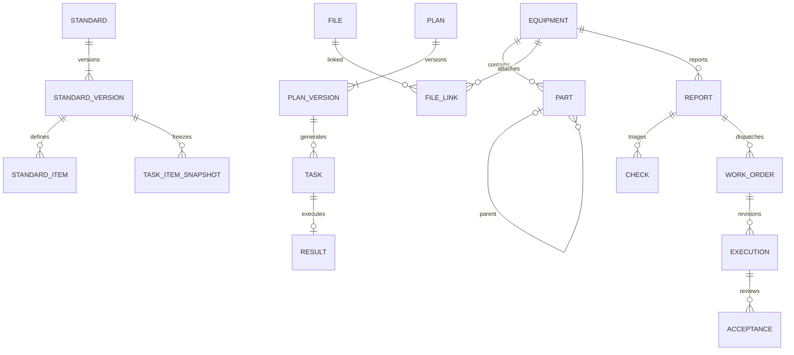

# 首批维护字段与数据关系补充

> 最新台账资料、点检计划多岗位/人员及任务改派规则，以[本轮设计](../页面设计/2026-10-10-台账资料与点检责任设计.md)和逐页登记为准；以下旧字段/操作为此前阶段记录。

日期：2026-10-10。与[操作矩阵](../页面设计/2026-10-10-首批页面操作矩阵与交互验收.md)共同作为当前逻辑基线。未执行建表，以下名称为目标逻辑表名。

| 对象 | 字段补充 | 关系/约束 |
| --- | --- | --- |
| eam_equipment | id、code(64)、name(100)、model(100)、location_path(200)、owner_person_id、manufacturer(100)、serial_no(100)、commissioned_date、criticality、lifecycle、revision、created_by/at、updated_by/at | code在租户/组织范围不区分大小写唯一；生产location_id关联位置主数据，path仅显示投影；设备版本用于乐观锁 |
| eam_equipment_part | id、equipment_id、code、name、parent_id、updated_by/at | equipment 1:N part；父部位同设备；业务层防环；同设备code唯一；有子记录/业务引用不可删 |
| eam_asset_file / eam_file_link | id、storage_file_id、equipment_id、category、name、revision、mime_type、size_bytes、status、uploaded_by、received_at、removed_by/at、remove_reason | 文件对象1:N关联；生产版本库/文件内容独立存储；原型assetFiles只保存元数据且直接设备关联；移除关系不删除历史 |
| eam_standard / eam_standard_version | 稳定标准ID、版本ID、revision、status、upper_limit、method、author_id、approved_by/at、disabled_by/at/reason | 本次standardHistory保留发布前版本；生产标准头1:N版本、版本1:N项目；发布后不可覆盖，草稿按起草人授权 |
| eam_route / eam_plan / eam_plan_version | 路线ID、计划ID、版本ID、route_name、frequency、window_start、assignee_id、status、author_id、approved_by/at、disabled_by/at/reason | 生产路线头1:N顺序设备/部位/项目绑定；计划1:N版本，任务关联计划版本；本批planHistory为版本数组 |
| eam_report_draft | id、author_id、equipment_id、description、severity、part_id、observed_at、intent、evidence、saved_at、revision | 当前会话按人员保存一个上报草稿；生产支持人员+对象多草稿；提交创建正式报告，移除草稿，不删除报告 |
| eam_abnormal_report | updated_by/at、withdrawn_by/at、withdraw_reason、status=withdrawn | part_id固定关联部位，part名称作为发现时快照；历史无ID的名称引用在改名时绑定固定ID；编辑保存前后审计；仅本人未受理非紧急人工报告允许；关闭/撤回退出未闭环投影；正式记录不删除 |
| eam_inspection_task / eam_check | cancel_reason、cancelled_by/at、status=cancelled | 未执行任务可取消；专项取消事务内将来源报告从checking回open；结果表不删、不覆盖 |
| eam_work_order | modified_by/at、change_reason、assignee_id、scope | 仅开工前可改；工单来源报告，执行版本引用工单，人员不是角色名称 |
| eam_work_execution | status=withdrawn、withdraw_reason、withdrawn_by/at、revision | 本人待验收完工、无验收记录才能撤回；重新执行新增版本，不修改原完工快照 |
| eam_audit_event | object_type/id、command、actor_id、role_snapshot、before/after、reason、event_time、received_at、revision | 所有修改/删除/撤回/停用留审计；草稿物理删除前留快照；生产按租户授权和保留策略控制 |

## 关系图

设备详情/工作台/履历属于查询聚合，不按页面新建业务表。设备运行、生命周期、健康和使用许可仍独立。新维护关系不改变旧调用方兼容边界。

## 物理设计待决项

下一阶段统一确定租户/组织隔离、ID类型、外键、唯一键、事务边界、并发版本、审批流程、文件存储和审计保留。原型单设备流程及单标准/单计划版本模型不可直接照搬生产。表中取消/撤回操作人员和时间字段须在原型命令中保存，并在生产服务由服务端身份生成。
