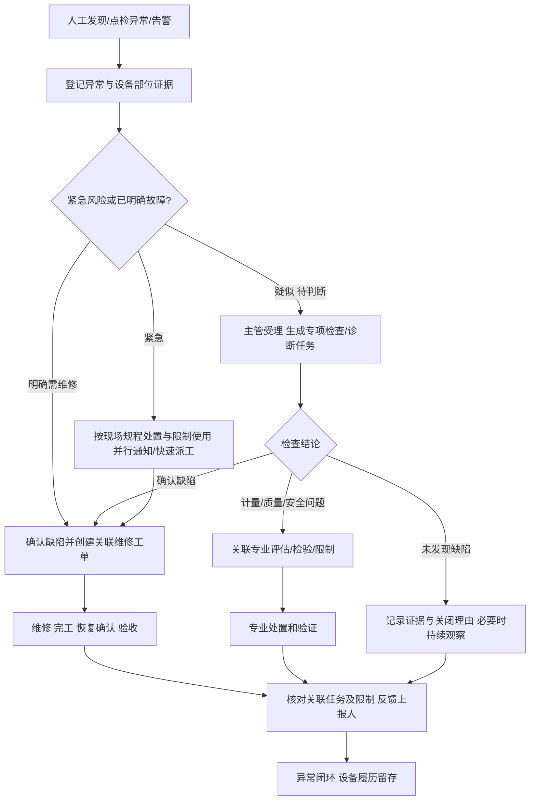

# 设备全景台账、异常分流与点检准备设计

日期：2026-10-10。版本：v0.1。状态：设计补充，HTML和数据库未实现。继承平台→设备管理二级主页面、角色授权、旧调用方暂不改和独立HTML的约束。本设计补入首批补全范围，不表示开始下一批。

## 1. 设备台账作为全生命周期入口

当前equipment/device只是单设备查询和静态概况；确实缺少图片/3D、完整树和全生命周期聚合。既有E02设备结构、E03生命周期、E04资料、D01履历有菜单蓝图，但台账没有集成。采用“设备树＋设备列表＋设备全景档案”，既可从设备看所有授权关联记录，也可从专业菜单批量处理同一批对象；不重复建业务数据。

### PC呈现

- 台账左侧是可折叠树：按位置查看“组织/区域→产线→设备”，按设备结构查看“父设备→子设备→部位”。位置树与资产组成树分开，不把组织节点当设备。搜索命中自动定位，树按权限懒加载；默认不把整个企业树展开。
- 右侧列表可切卡片，显示缩略图、编码/名称、位置、关键度、责任人、多维状态、最近更新时间和未闭环事项；多条件筛选/分页，行点击进入独立device.html全景档案。
- 档案头固定设备名称、编码、主图、位置路径、责任人与当前限制。运行/健康/生命周期/计量/安全许可分别展示，给出来源、时间和“未知/待确认”；未闭环异常不直接判定故障。动作按资格/关系/状态显示：上报异常、临时检查申请、查询任务、生命周期变更。
- 首页“概览”给关键参数、当前风险/限制、待办、近期趋势和最近履历，不一次加载全部历史。完整内容在页签按需查询。

| 档案页签 | 内容 | 对应既有专业入口 |
| --- | --- | --- |
| 概览 | 主图、身份/责任/参数、各维状态、未闭环事项、风险摘要 | E01/W01/O01 |
| 结构与部位 | 子设备、检修部位、测点、关联备件；选择部位查看记录 | E02/O05/S02 |
| 图片与3D | 外观/铭牌/安装/检修照片、模型版本及部位热点 | E04，台账内查看 |
| 技术资料 | 说明书、图纸、证书、作业文件、受控版本/有效性 | E04/T02/T03 |
| 点检与维护 | 适用标准、路线/计划、下次到期、任务/结果、缺陷/维修保养 | I01-I04/M01-M06 |
| 状态与趋势 | 当前状态来源、原始事件、测点趋势、启停与停机区间 | O01-O06/A02 |
| 生命周期履历 | 建档/采购来源、安装/验收投用、调拨、改造、停用、恢复、报废处置，以及日常作业时间线 | E03/D01 |
| 风险与合规 | 适用要求、安全风险/许可、校准/检验、到期和使用限制 | R01/R02/C01-C05/T04 |
| 备件与成本 | BOM、领退料、工时/外包成本及来源口径 | S01-S04/A06 |

全部页签可由台账进入，按授权和适用性显示“无记录/不适用/无权限/来源不可用”；不能把无权限显示成无数据。履历支持按事件类型/时间/部位筛选，展开原记录版本、证据和状态前后变化；当前组织变化后仍保留历史归属。采购/财务/库存信息引用权威系统，不在EAM重复造账。数据缺失显示来源待补，不虚构完整历史。

### 移动呈现

扫码/手工编码→设备档案，顶部主图、状态/限制及主要操作；“概览、作业、资料、履历”四个局部页签，结构/风险/成本通过概览卡片展开。树采用路径＋逐级选择/搜索，长表变卡片。图片与文档独立预览返回保留设备上下文；3D按用户打开懒加载，低性能/格式不支持时回退图片/部位列表。模块入口仍来自系统平台。

### 图片、资料和3D规则

图片区分主图/铭牌/安装/故障证据，带拍摄时间、部位和来源；上传资格与对象权限一致。资料带分类、版本、发布状态、批准/有效期与替代关系，历史工单仍引用当时版本。3D是可选技术资产，**不是所有设备必填，更不等同数字孪生**：首期设计预留GLB/glTF等网页模型和静态预览图，实际格式/大小/转换方案在实施前验证；热点绑定真实部位/测点ID，模型版本与部位绑定同时受控。文件在平台文件/对象存储，数据库保存引用、元数据和关联，不把模型二进制存进设备行。缺模型不能阻断普通点检/维修。

## 2. 多维状态与状态机

设备没有一个能覆盖所有情况的state字段。各维保存自己的合法迁移、来源、时间和版本；界面聚合展示。

| 维度 | 建议状态/来源 | 约束 |
| --- | --- | --- |
| 生命周期 | 草稿→待验收→在用；在用↔停用；在用/停用→待报废→已报废；退回回到原合法状态 | 受控变更与投用证据；改造/调拨是事件和审批单，不强塞为互斥状态；采购/安装进度关联项目记录 |
| 运行 | 运行、待机、停机、未知；有效采集或授权人工修正 | 故障不必然停机；陈旧信号转未知；业务页面不发送实际控制指令 |
| 健康 | 正常、预警、故障、待验证 | 疑似异常等待判断；未证实不能直接判故障；维修验收后按其他未闭环问题重评 |
| 计量 | 不适用、待确认、有效、到期、不合格 | 用途与计量确认规则；维修不能直接延长证书有效期 |
| 安全/用途许可 | 可用、限制、禁止，按用途/范围 | 汇总风险、专项检验、隔离/许可及未解除限制；显示阻断来源/责任人 |

状态变化记录before/after、原因、来源对象/版本、操作者、事件/接收时间。每个审批节点拥有有权处理人、退回/取消路径。正式迁移矩阵在首批字段/接口补全时形成，不能靠前端自由选择任何状态。

## 3. 人工发现异常：先上报，再分流

“报检”容易与法定检验混淆，现场建议统一按钮“上报异常”，允许注明“希望检查/已知故障需维修”，但意向不是最终任务类型。另保留“申请临时检查”用于无异常的预防性核查；“紧急报修”是上报异常的快捷情境。已有M01路由/旧报修接口保留，扩展为异常受理与缺陷处置；C05专项检验仍是独立专业流程。

| 情境 | 触发对象 | 处理责任/关闭要求 |
| --- | --- | --- |
| 异响但原因不明、疑似温度偏高 | 异常报告＋专项检查/诊断任务 | 班组长/工程师受理，点检/诊断人员核查；可未发现缺陷，但结论与证据必留 |
| 漏油、部件断裂等已确认需修复 | 异常报告/确认缺陷＋维修工单 | 可以直接派工，不强制先补一条例行点检；执行、验收职责分离 |
| 高风险/紧急故障 | 紧急异常＋限制/现场处置＋快速工单 | 不等待普通审批才按现场制度处置；授权人员快速派工，事后补齐记录受期限控制 |
| 周期点检发现超限 | 保留原点检结果，关联异常；按规则需人工复核或确认缺陷 | 不能所有超限都直接定故障；例行任务提交和异常关闭各有状态 |
| 怀疑测量失准、法定检验到期 | 专业计量/检验/影响评估任务及相应限制 | 普通维修验收不能替代专业确认，明确源记录关联 |

异常报告≠已确认缺陷≠工单：报告保存观察事实与原始证据，缺陷保存专业判断，任务负责检查/处置。一个报告可关联多个检查/维修/专业对象；同一故障的多份报告可以人工确认关联同一缺陷，保留每次上报，不生成重复执行任务。检查不通过/诊断未明可追加检查或升级主管，不自动关闭；计划内已完成任务不重开，新增独立专项任务。

报告状态：submitted→triaging→checking/handling→pending_verification→closed；处理意向与最终分流独立保存；撤回/重复关联/未发现缺陷必须理由、权限及证据。上报人可见进展，退回补证、无人受理、任务逾期、权限/资格失败均有主管队列及升级。关闭核对所有必要关联任务及处置，未解除限制显式显示，不把报告关闭当放行。

## 4. 点检必须预维护，但临时检查可受控创建

例行点检需要先维护设备/部位/测点、标准项目、适用规则、路线、计划频次和人员授权。三类对象分清：标准定义“检查什么/怎么判”，路线定义“去哪/按何顺序”，计划定义“何时/多频繁/谁执行”。**频次是计划任务组属性，不是整条路线强制统一频次**；同设备的不同项目可按每班、每日、每周分别编组，最终生成时展示本次到期项目。

| 预维护对象 | 关键字段/规则 | 既有入口 |
| --- | --- | --- |
| 项目与标准版本 | 分类模板/设备/部位适用、项目编码/方法、结果类型、单位/量程/阈值、必检、证据、资格、安全条件、有效期/审批 | T02；维护作业T03 |
| 设备项目绑定 | equipment/part/point＋standard_item_revision、启用范围/有效期、受控设备特定阈值 | T02与设备档案点检页签 |
| 路线版本 | 名称、区域/设备范围、停靠点顺序、项目分组、预计时长、安全访问条件、责任班组 | I01路线标签 |
| 计划版本 | 路线或设备范围、标准版本、触发方式、时区/班次/日历、周期/窗口、责任人员/替代规则、提前生成、漏检/延期规则 | I01计划标签 |
| 周期任务实例 | 到期窗口、人员、实际命中设备/项目、标准/路线/计划快照、提交与复核策略 | I02；生成失败在I04 |

建议流程：工程师起草标准与设备适用配置→授权专业人审核/发布→主管配置路线与计划→审批启用→按频次生成任务→执行逐项结果→复核/完成→异常受理→分析调整标准/频次。标准和计划可分别发布，但启用计划必须校验引用有效版本、完整设备项目及合法人员。

频次依制造商建议、风险/关键度、故障历史、工况和适用要求制定；不统一写死“每台每天一次”。支持每班/日/周/月、运行小时/次数、事件触发与临时任务；触发器配置是否组合及优先/合并策略。月末/节假日/停用/停机窗口、时区、08:00业务日须明示；停用不静默延期法定校准/检验期限。增加频次形成策略版本并只影响将来任务；已有实例保留原快照。

任务生成去重键包含计划版本、设备/停靠点、项目组、触发窗口/实例序号；合并不同计划任务时保留各自来源，不因路线相同吞掉不同频次。路线是操作导航，不替代设备本身的资格和安全规则。临时检查可脱离例行路线/周期，由授权人选择项目/标准或填写受控一次性方法与判定要求；保存申请、原因、截止时间及批准依据，不改动长期计划。移动端只显示本次到期项目、路线顺序和安全要求。

## 5. 数据结构增补（逻辑草案）

以下补充[首批字段字典](../数据设计/首批数据结构字典.md)，沿用其通用字段/版本/审计/平台引用约束；未执行DDL。

| 对象 | 核心字段与关系 |
| --- | --- |
| eam_equipment_part / 部位 | equipment_id、parent_part_id、code、name、type、effective_from/to；不能将无独立资产身份的部位复制成设备；映射部件更换历史 |
| eam_equipment_media / 技术资产关联 | equipment_id、part_id可空、file_id/revision、kind（主图/照片/资料/3D）、title、sequence、status、effective_at；文件元数据引用平台 |
| eam_model_revision / 3D版本 | equipment_id、model_file_id/revision、format、preview_file_id、unit、coordinate_system、revision、approval/status；可空配置无模型设备 |
| eam_model_binding / 热点绑定 | model_revision_id、node_key、part_id/point_id、binding_type、position/transform；节点与设备范围一致，改版重新校验 |
| eam_lifecycle_change / 变更单 | equipment_id、type、before/after_snapshot、reason、effective_at、approval_reference、status、evidence_reference；指向投用/调拨/改造/停用/报废证据 |
| eam_abnormal_report / 异常事实 | equipment_id、part_id/point_id、source/type/id、description、observed_at、reporter_id、reported_at、urgency、requested_action、triage_decision/by/at、status、closure_reason/by/at；不以布尔值直接变故障 |
| eam_abnormal_relation / 处置关联 | report_id、target_type/id/version、relation_purpose、required_for_closure、linked_by/at；关联专项检查、缺陷、工单、专业评估 |
| eam_equipment_inspection_binding / 设备项目适用 | equipment_id、part_id/point_id、standard_item_revision_id、scope、effective_from/to、override_rule_revision、approval_reference |
| eam_inspection_route_revision / 路线版本 | route_id、revision、name、area/scope、team_id、estimated_seconds、status、effective_from/to、approval_reference |
| eam_inspection_route_stop / 停靠点 | route_revision_id、sequence、equipment_id、part_id/point_id、access_rule_snapshot；项目组与停靠点关联 |
| eam_inspection_plan_revision / 计划版本 | plan_id、revision、route_revision_id可空、equipment_scope、trigger_policy、timezone、calendar/shift、schedule_expression、due_window、assignee_rule、exception_rule、review_policy、status、effective_from/to |
| eam_inspection_plan_item_group / 频次项目组 | plan_revision_id、group_code、applicable_binding_ids或关联明细、trigger/interval、execution_window、merge_policy；多值正式建关联表不存无约束ID数组 |
| eam_inspection_task 扩展 | task_type（routine/special/diagnostic）、source_report_id可空、plan/route_revision可空、item_group_id、trigger_instance_key、reason、due_at、scope_snapshot；非例行任务无plan_id合理 |

完整表/字段类型、关联约束、状态迁移矩阵和接口在首批补全中进一步展开；设备状态历史沿用state_event/audit_event而不是复制一张每维独立履历真值表。新异常报告可对旧报修契约适配为同一业务入口，具体旧响应映射仍待契约设计。

## 6. 首批补全与验收新增

- 台账树与列表切换；任一设备可进入图片、资料、可选3D/回退、全生命周期履历，并回到同一上下文；权限/适用性/不可用状态明确。
- 多维状态独立，故障但运行/停机但正常/信号未知可同时正确显示；报废不新建常规作业，必要处置有专门授权。
- 疑似异常→检查→未发现缺陷和确认维修两条路径；明确故障直接派工；紧急现场处置不被常规审批阻塞。
- 点检超限经规则分流；多报告同缺陷可追溯；专业限制不随普通维修验收解除；检查退回/逾期能恢复。
- 同一路线多设备不同项目，同设备多频次，任务只包含本次到期项；版本更改不改旧任务，重复调度不多生成。
- 例行与临时任务来源清晰，临时检查不要求先建长期计划；错误/停用/替班/跨业务日规则明确。

## 7. 依据与边界

[ISO 55001:2024](https://www.iso.org/standard/83054.html)为资产生命周期、风险和价值管理提供参考；[ISO 17359:2018](https://www.iso.org/standard/71194.html)为机器状态监测程序提供参考。上述页面组织、异常分流、表结构和发布流程是本项目设计选择，不是标准直接规定“报检或报修”，也不表示3D是认证必需项。法定专项检验/计量周期必须按设备所在地、类别和用途另外核验。
