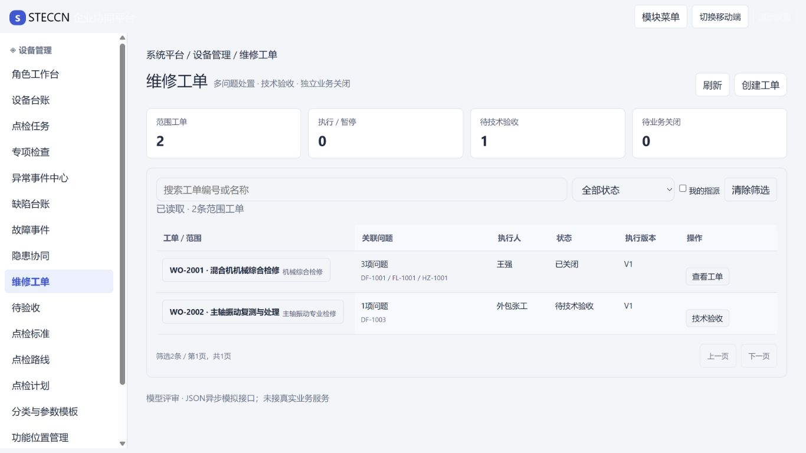

# Bootstrap 5 样式迁移评审

日期：2026-10-10。只读评审，未修改用户本次样式代码。检查设备台账、维修工单列表、异常分诊弹窗；1366×768、390×844、桌面移动预览、浅/深主题与菜单抽屉。不是25页全量视觉验收。

## 结论

引入Bootstrap后组件基础可复用，但迁移尚未完成。共享CSS优先级、组件局部变量、旧脚本生成类和新布局规则之间存在冲突，影响实际可读性与动作识别。

| 优先级 | 缺陷及证据 | 修正方向 |
| --- | --- | --- |
| P1 | 顶部背景透明，平台副标题使用白色50%透明，演示设置使用outline-light，浅色页面几乎看不到。浏览器header背景rgba(0,0,0,0)，副标题rgba(255,255,255,.5) | 顶部明确深底白字或浅底深字，并统一导航主题 |
| P1 | 创建工单已有btn btn-primary，计算背景白色、文字深色，刷新与创建视觉近似。Bootstrap放入最低bootstrap层，app.css不分层的全局button规则覆盖组件。其局部--bs-btn-bg仍#0d6efd，root品牌映射不能覆盖组件内局部定义 | 取消全局组件覆盖，按btn变体和局部变量配置品牌与hover/focus/disabled |
| P1 | 抽屉z-index=60，顶部sticky-top=1020。移动预览打开菜单时品牌覆盖抽屉关闭区域 | 统一导航/遮罩/抽屉/评审菜单/弹窗/toast层级 |
| P2 | work-ui/problem-page动态生成的状态仍是problem-badge，当前无完整状态规则或Bootstrap badge映射。已关闭与待验收显示普通文本 | 静态HTML和动态DOM统一语义badge映射，避免只迁移HTML |
| P2 | 台账card实际背景rgb(243,245,249)，与页面背景同色。root --bs-card-bg映射被组件局部变量覆盖，信息分区变弱 | 在组件作用域设置表面变量；统一表格、卡片和详情层级 |
| P2 | 手机台账首屏主要是平台栏、标题、设备导航、工具栏和四个统计卡，实际设备记录接近屏底；桌面mobile-preview仍铺满宽屏，只底栏限制440px | 折叠次要指标与工具，移动预览明确采用窄容器或真实视口，不混合两种版式 |
| P2 | app.css实际1218行，保留旧布局、业务和组件全局规则，文件说明却称仅最小骨架；迁移治理没有收敛 | 分开tokens/Bootstrap组件配置/外壳/页面模块，清理重复规则，不要求消灭必要业务CSS |
| P3 | app.css ui-spin被写成选择器而非@keyframes，aria-busy动画引用ui-spin却没有有效关键帧 | 修正动画定义并检查减少运动偏好 |
| P2风险 | Bootstrap仅从CDN @import，无本地依赖备用，源码明确离线回退浏览器默认样式 | 工业内网及离线评审采用固定版本本地资源；这是部署可用性风险，未模拟断网 |

## 已观察到的正常项与范围

PC台账及手机宽度未发现整页横向溢出；原生分诊dialog可打开，有内部滚动及底部操作区。深色台账表格文字/背景随已映射变量变化，不能宣称暗色完全失效；仍需检查其他原生Bootstrap控件及状态色。完整页面、键盘全路径、所有错误/加载状态未全量验证。

本轮只记录问题，不改业务JSON、模拟接口、候选表或接口数量。此前82业务测试通过不证明此次样式迁移视觉通过。

源码入口：[公共样式](../../prototype/shared/style.css)、[应用CSS](../../prototype/shared/app.css)、[导航](../../prototype/shared/navigation.js)、[令牌](../../prototype/shared/styles/令牌.css)、[动态组件](../../prototype/scripts/work-ui.js)。
