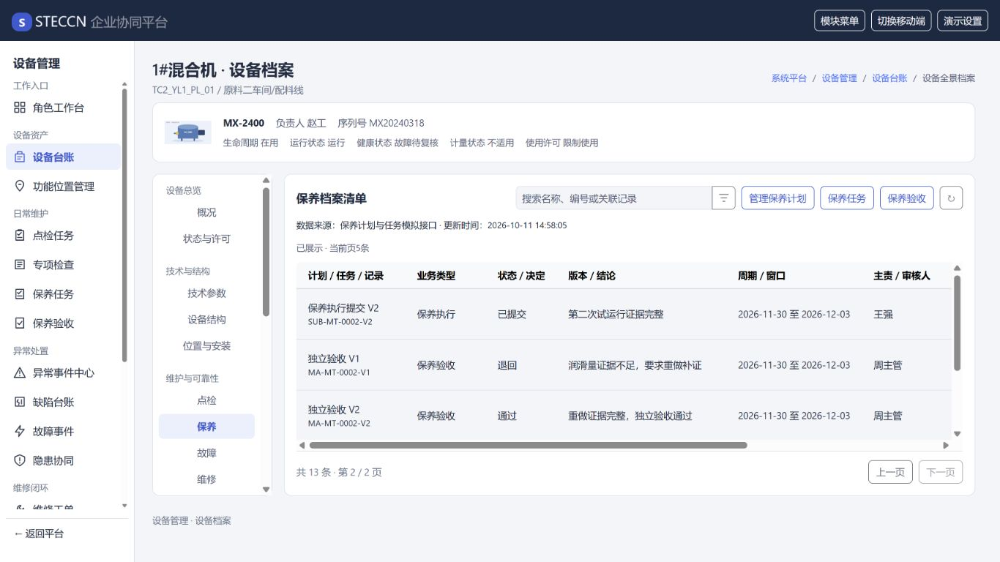
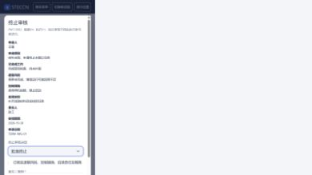

# 保养闭环第三批交付与验收记录

日期：2026-10-11。范围为HTML高保真与JSON模拟接口；未改正式数据库、后端或调用方。

## 已交付

新增日常维护下“保养验收”独立页面与同源待审队列。任务详情静态表单支持独立验收、退回重做、终止申请及审核。冻结提交、参与者、决定、证据和历史执行版本可分页查看快照；申请终止必须填写已完成工作、风险、控制、后续安排、责任、期限、证据。

验收退回创建空白新执行版本并暂停，安全复核后重做。终止待审冻结执行与改派；驳回保持暂停，批准终止。执行参与者不得独立审核。乐观数据版本、执行版本、终止申请版本及既有命令幂等机制防止过期或重复操作。

设备档案保养、生命周期与审计读取维护模块同源投影；不再复制保养样本。来源单据导航保留设备及保养页返回上下文。业务配置、数据和方法均位于JS JSON及模拟API，HTML只承载独立布局和静态表单。

## 证据

本地Node测试134/134通过；设计一致性60菜单/60总表/30独立HTML/506文档引用，零错误；样式工程9文件零错误。独立审查未发现必须修复的重要缺陷。

浏览器实际完成直接验收通过、V1退回再执行V2验收、终止申请批准三条路径；验收快照展示原始证据，档案同源共13条。检验1366×768、1024×600及390×844窗口，低高度详情内部可滚动、快照关闭可达，移动终止表单成功提交。审核队列加载/空态与权限、驳回后恢复、关联问题不关闭由本地测试覆盖。浏览器验收明细：[JSON证据](保养闭环第三批浏览器验收证据.json)。

## 候选结构与边界

新增逐页[保养验收与审核记录](../页面记录/保养验收与审核-页面数据与接口记录.md)，页面登记.json统一记录候选submission/acceptance/termination/review表与接口；菜单总表保持60项，独立审核为M04子入口。正式结构仍需全部页面模型完成后统一设计。

验收或终止不自动关闭异常、隐患、缺陷、故障及设备使用限制，不解除作业许可。遗留后续安排保存责任人和期限，尚不自动创建后续任务；导入业务尚未启用。未运行真实后端或CI，不能据此声称正式生产闭环或体系认证完成。临时浏览器已关闭、测试视口已恢复。
