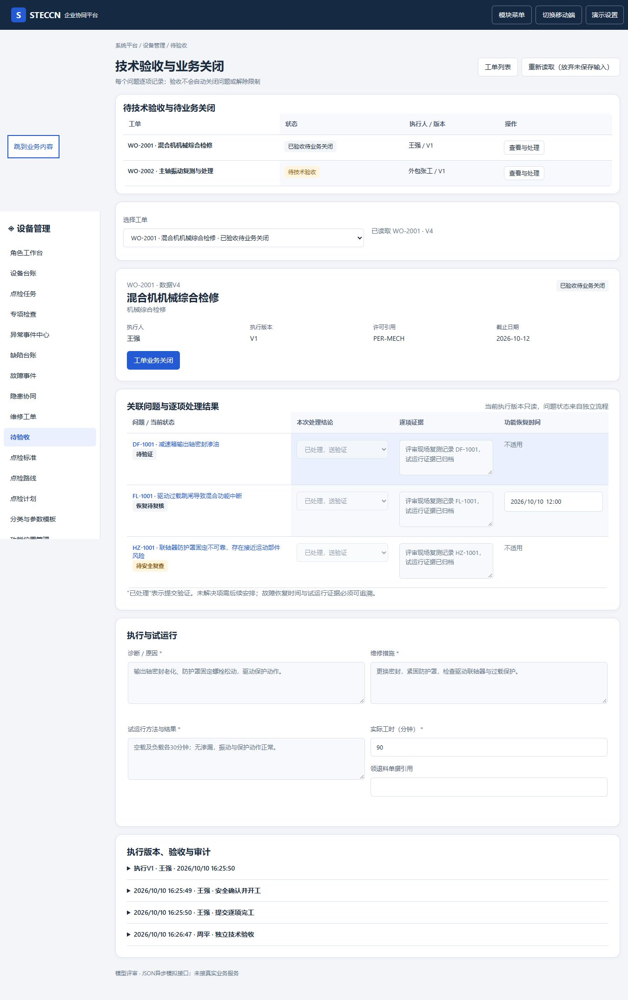
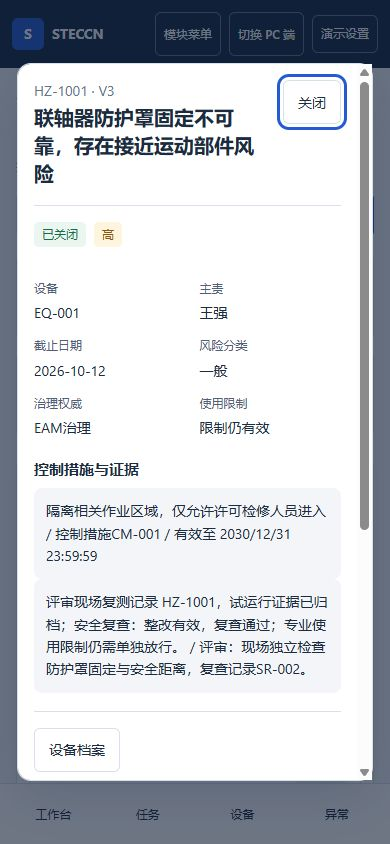

# 工单验收与隐患协同交付与验收

日期：2026-10-10。本批实现维修工单列表、执行详情、技术验收与业务关闭、隐患协同；保留独立HTML，未改造生产EAM数据库、服务或现有调用方。

## 页面与业务闭环

| 页面 | 本批交付 |
| --- | --- |
| [维修工单](../../prototype/pages/order-list.html) | 筛选/分页、问题候选引用、创建草稿；同问题同活动范围去重 |
| [维修执行](../../prototype/pages/order.html) | 独立审核、派工/改派、资格/许可/隔离/防护、执行草稿、逐问题结论/证据、故障恢复时间、暂停、返工版本历史 |
| [维护验收](../../prototype/pages/acceptance.html) | 待验收/待业务关闭队列；独立技术验收、退回返工、业务关闭及残留安排；不默认打开最后记录 |
| [隐患协同](../../prototype/pages/hazards.html) | 列表/详情、分类核实、控制有效期、整改提交、独立安全复查、限制独立放行、模拟EHS权威回执 |

工作台的工单/异常/隐患队列已读取同一模拟接口；发现可分诊为隐患，缺陷/故障/隐患详情可创建关联工单。旧异常详情入口改为来源兼容跳转；旧单据不能通过旧验收入口连带关闭独立问题。未被本批迁移的点检/标准仍沿用原会话模型。

技术验收通过只把已处理项送独立验证：缺陷待验证、故障恢复待复核、本地一般隐患待安全复查；未解决项保持原状态。问题版本变化时跨对象事务拒绝，不能部分更新。返工回待开工，重新确认安全后生成新执行版本，已完工版本冻结。

业务关闭要求残留问题有真实的同问题后续活动工单且已独立审核、责任人、未来期限、控制有效期覆盖期限。重大隐患未权威关闭阻止业务关闭；已验收工单不允许通过终止绕过关闭要求。未开工终止保留问题，已开工终止还须现场恢复证据。

隐患风险核实是作业与送审门槛，未知分类不默认一般；本地重大隐患按本批配置转权威治理，未提供真实转EHS接口，保持阻断。EHS示例仅读取预定义回执，旧外部版本不会倒退状态；关闭不释放专业使用限制。安全放行独立授权、独立整改人并留证。

## JSON与模拟接口规则

所有本批业务数据预定义于 `mock/work-data.js` / `mock/problem-data.js`。HTML只定义布局与表单，控制器通过 `EamProblemApi.request(method,path,payload)` 异步取数和提交；不得直接修改JSON对象或使用旧closeReport。`work-rules.js`无DOM，命令在事务副本执行；全部校验通过后一次保存、生成主对象及关联问题审计。

模拟路径省略候选正式路径的 `/eam` 前缀，候选方法在逐页登记中可追溯。`GET /work-config` 提供字典、资格、许可及权威回执评审样本；`GET /work-order-candidates` 提供建单问题候选。POST命令为 approve/assign/start/save/complete/accept/close/pause/cancel，以及隐患 assess/control/submit/review/release/sync。写入带对象版本，验收额外带冻结的问题版本；创建带幂等键。数据保存在浏览器会话，不是真实HTTP、服务器事务或生产权限。

工单读取采用令牌丢弃过期响应，读取期间禁用旧详情。命令弹窗固定对象ID、对象版本及执行上下文，提交失败保留输入；隐患详情同样丢弃过期读取并固定命令目标。工单优先级从关联问题最高等级派生，避免新建默认降级。

## 字段关系记录

不按页面建表。工单与问题通过引用关系多对多关联；执行版本一对多逐项结果，冻结问题版本与恢复时间；技术验收引用执行版本；业务关闭、残留安排及独立问题验证分离。隐患分类核实、控制措施、整改复查、权威回执、使用限制各有独立证据与版本。候选结构及接口见[逐页索引](../页面记录/首批页面候选数据与接口索引.md)，正式DDL/外键/索引/DTO/OpenAPI等在全部模型完成后统一设计。

本轮25个独立HTML及25份逐页登记、131项候选方法/路径、60菜单映射。覆盖16个菜单的部分场景，44个菜单仍只有概要；不能理解为60项菜单已经实现。

## 验收证据

- 本地规则回归：80项通过，其中工单隐患14项。覆盖自验拒绝、漏项/重复项、资格阻断、同范围去重、问题版本冲突回滚、返工快照、残留后续审核与控制覆盖、未分类/重大隐患跨入口拦截、独立复查/放行、外部旧回执与已验收终止拦截。
- 浏览器PC 1366×768：本人指派工单安全开工→三个问题逐项结果→技术完成→切换独立班组长验收→分别送验证→业务关闭；页面宽度1366，无整页横向溢出。
- 浏览器移动390×844：安全人员独立复查本地隐患→隐患关闭且限制仍有效；页面宽度390，无整页横向溢出。专业放行规则由接口测试验证，不宣称浏览器真实作业安全验证。
- 独立代码审查指出风险分类跨入口绕过、异步命令对象漂移、已验收终止绕过；本批修复并补回归，最终只读复核确认三项修复，限定范围无新增阻断问题。正式后端鉴权/并发/事务不在此证据内。
- 文档一致性：60菜单、25HTML、25页面登记、文档相对链接无错误；维护登记8对象状态、12规则、8菜单引用检查通过（设计检查）。

## 后续边界

设备档案仍为独立历史样本聚合，尚未实时聚合新问题/工单/隐患数据；下一批先迁移档案与点检发现关联，再展开保养策略/计划/任务。未实施真实EHS连接、许可签发、实际领料、成本结算、租户/组织隔离或生产API。权威回执迟到处理已保证外部版本不倒退，但真实签名验真、重复回调审计与重放保护仍待统一接口设计。
