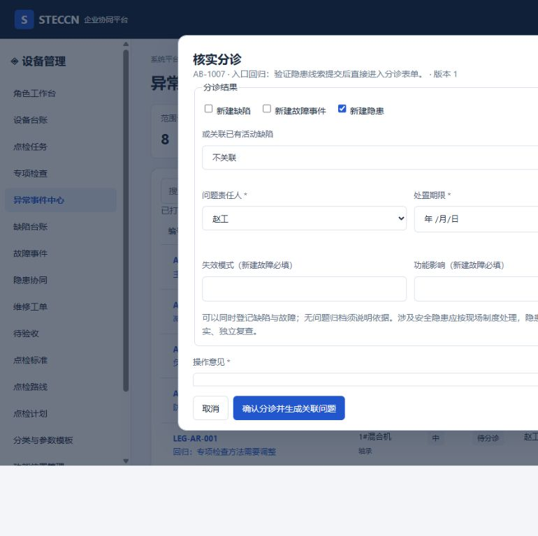

# 流转按钮与分诊入口修复记录

日期：2026-10-10。用户反馈创建/归档/下一节点按钮不可发现，隐患页点击分诊只进入异常事件中心，没有表单。

## 根因与修复

隐患页原“从异常分诊登记”是普通data-page导航，只带页面名，没有create参数、问题类型或分诊动作。异常列表行的分诊表单本身存在；不能以此推断所有入口可用。工作台原入口也只打开对象详情，没有明确action。

本轮：隐患页改“登记隐患线索”，跳转create=1&problemKind=hazards直接打开事实表单。缺陷/故障页同样提供线索登记入口。工程师/班组长提交发现成功后打开该对象的分诊表单，按来源预选问题类型；现场角色只上报，等待授权人员核实。分诊仍不是直接创建已确认隐患，风险分类另由安全人员核实。

支持id+action=triage进入对应分诊表单，工作台待分诊入口已带动作。列表保留主要状态动作，增加详情、创建工单和归档显式按钮。异常列表和详情提供归档；POST模拟接口须授权、对象版本、意见和核实证据，关联问题全部关闭才可归档；无关联的高优先级发现不得直接归档。归档不会关闭关联问题。

业务数据和方法继续经JSON异步模拟接口，不直接写页面状态。分诊弹窗固定命令对象和版本，读取显示加载信息。真实数据库/API未实施。

## 验收与候选记录

接口回归补归档授权、证据、高优先级及未关闭关联问题拦截。浏览器验证隐患登记→发现表单→授权分诊预选隐患，以及显式归档。逐页登记增加候选archive接口，正式设计仍在模型完成后统一进行。

当前25HTML、25逐页登记、132候选接口、60菜单；82项本地测试通过。此修复不代表直接隐患登记、EHS连接或所有流程完善。

[进度](../../设计与原型进度.md) · [逐页登记](../页面记录/首批页面候选数据与接口索引.md)
